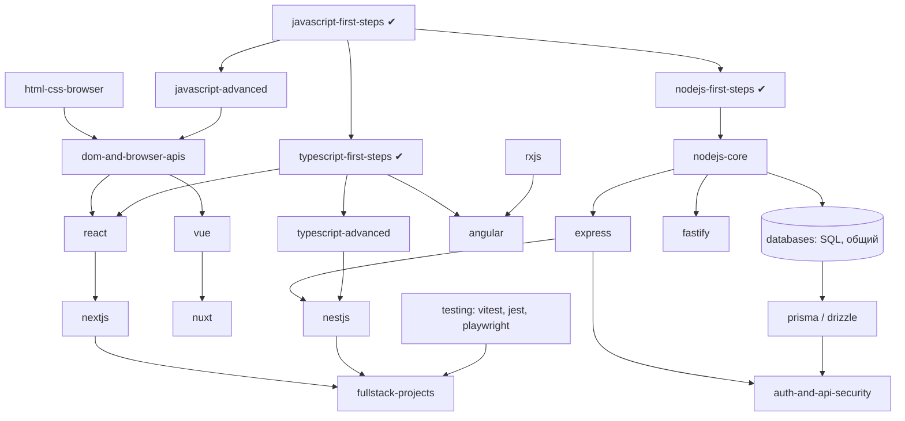

# Экосистема JavaScript / TypeScript: траектории обучения

Статус: из всего описанного ниже реализованы только вводные курсы `javascript-first-steps`, `typescript-first-steps`,
`nodejs-first-steps` (по 2 урока, одиночные файлы). Остальное - **Planned**. Идентификаторы курсов - рабочие предложения.
Общая модель: [CURRICULUM.md](../../CURRICULUM.md). Требования: [docs/requirements/ecosystem-expansions.md](../requirements/ecosystem-expansions.md).
Версионно-зависимые утверждения ниже помечены «сверить»: проверяются по актуальной документации в момент написания курса.

## 1. Разграничение понятий (первый урок каждого трека)

| Понятие | Что это | Типичная путаница |
|---|---|---|
| JavaScript | Язык (ECMAScript) | «JS = браузер» |
| TypeScript | Типизированная надстройка над JS; типы стираются при компиляции | Типы не проверяют данные во время выполнения; `any` / `unknown` / `never` - разные вещи; код с типами всё равно может упасть |
| Node.js | Среда выполнения JS вне браузера (V8 + libuv) | Не язык и не веб-фреймворк |
| React | UI-библиотека | Не фреймворк приложения |
| Vue | Прогрессивный фреймворк | - |
| Angular | Полноценный application framework на TypeScript | - |
| Next.js | Fullstack-фреймворк поверх React | Не заменяет React |
| Nuxt | Fullstack-фреймворк поверх Vue | Аналог Next.js со своей архитектурой |

## 2. Граф маршрутов

Каждый маршрут - отдельный путь обучения (`paths/*.yaml`) поверх общего графа курсов. Общие курсы (алгоритмы, SQL, сети,
HTTP) учатся один раз.

Именованные маршруты: JS Fundamentals · Advanced JS · TS Fundamentals · Advanced TS · Node.js · Frontend · Backend ·
Fullstack · Desktop (Electron, Tauri) · Testing & QA · Performance · Runtime Internals · JS AI/ML.
Примеры траекторий (граф, не фиксированный список):
React-разработчик: JS → Advanced JS → TS → HTML/CSS/Browser → React → Hooks → архитектура компонентов → состояние →
маршрутизация → получение данных → Next.js → тестирование → производительность → проект.
Vue-разработчик: … → Vue → Composition API → Router → Pinia → Nuxt → …
Angular: … → DI → Signals → RxJS → Router → Forms → HTTP → тесты → SSR.
Node backend: JS → Advanced JS → TS → Node → HTTP → Express | Fastify → PostgreSQL → ORM → auth → тесты → NestJS (опц.) →
кэш → очереди → проект.

## 3. Курсы: зависимости, сложность, критерии мастерства

Уровень - ориентир 0-6 (CURRICULUM.md §2). «Движок» - что нужно от DevAcademy сверх текущих возможностей.

| Курс | Ур. | Требует | Технологии | Проверяемые навыки (mastery) | Движок |
|---|---|---|---|---|---|
| `javascript-first-steps` ✔ | 0 | - | V8, stdin, `===` vs `==` | Предсказать результат сравнений; прочитать stdin и вывести результат | есть |
| `javascript-core` | 1 | first-steps | типы и приведение, объекты, прототипы, замыкания, `this`, модули ESM | Объяснить цепочку прототипов на примере; написать функцию с замыканием-счётчиком; исправить потерю `this` | есть (одиночные файлы) |
| `javascript-advanced` | 3 | core | цикл событий, microtasks vs macrotasks, промисы, async/await, итераторы, генераторы, Proxy/Reflect, WeakRef | Предсказать порядок вывода `setTimeout` / `Promise` / `queueMicrotask`; реализовать `Promise.all` с ограничением параллелизма | есть |
| `typescript-first-steps` ✔ | 1 | JS | tsc / type-stripping, границы типов | Объяснить, почему типы стираются | есть |
| `typescript-core` | 2 | TS first | структурная типизация, union, generics, сужение, `unknown` vs `any`, `satisfies`, `tsconfig` | Типизировать функцию-обёртку без `any`; написать type guard; объяснить, чего тип не гарантирует (данные JSON) | tsc через Command evaluator (**Planned**); сейчас - вывод запуском |
| `typescript-advanced` | 4 | TS core | условные и mapped типы, `infer`, template literal types, variance, declaration merging | Реализовать `DeepReadonly`, `Awaited`-подобный тип; проходят тесты типов (`tsc`) | Command evaluator + `tsc` |
| `nodejs-first-steps` ✔ | 1 | JS | процесс, stdin | Прочитать вход процесса | есть |
| `nodejs-core` | 2 | JS core | event loop, libuv, streams, Buffers, `fs`, `http`, `net`, worker threads, child processes, ESM vs CJS, npm / pnpm | Реализовать потоковую обработку файла без загрузки в память; объяснить, что блокирует цикл событий | одиночные файлы; npm - Project Workspaces |
| `html-css-browser` | 1 | - | HTML5, CSS3, a11y, адаптивность, рендеринг | Вёрстка по макету, проходящая проверки DOM/ARIA | **Web preview module** (Planned); не WebView в основном UI |
| `dom-and-browser-apis` | 2 | JS core, html-css | DOM, события, Fetch, HTTP, WebSocket, storage, web perf | Реализовать компонент без фреймворка; обработать ошибки сети | Web preview + браузерный раннер (Planned) |
| `react` ✔ (`react-fundamentals`: компоненты, props, useState, события и формы, эффекты, Testing Library; Context, Router, оптимизация рендеров запланированы) | 3 | dom, TS core | компоненты, Hooks, Context, Router, формы, Testing Library, Vitest | Исправить лишние рендеры; написать тест на компонент; объяснить правила хуков | Workspaces + Command evaluator (Vitest) |
| `react-state-data` | 3 | react | Redux Toolkit, Zustand, TanStack Query, React Hook Form | Выбрать и обосновать хранилище состояния по критериям | то же |
| `nextjs` | 4 | react, nodejs-core | App Router, Server vs Client Components, стратегии рендеринга, Route Handlers, кэширование, аутентификация, middleware / proxy | Определить, что выполняется на сервере, а что в браузере; настроить кэширование маршрута. Версионные детали (например, переименование Middleware в Proxy в Next.js 16) фиксируются в `framework`-метаданных курса, сверить с актуальной документацией | Workspaces + dev server + preview |
| `vue` / `nuxt` | 3 / 4 | dom, TS core / vue | Vue 3, Composition API, Pinia, Router; Nuxt: файловая маршрутизация, auto-imports, server routes, режимы рендеринга | Аналогично React/Next | то же |
| `rxjs`, `angular` | 3 / 4 | TS core / rxjs | Angular CLI, DI, Signals, Router, Reactive Forms, HttpClient, SSR, NgRx | Построить форму с валидацией на реактивных формах; корректно отписаться от потоков | Workspaces + CLI |
| `express` ✔ (`express-fundamentals`: Express 5, middleware, роутеры, ошибки, проверка данных и безопасность, REST, тесты через light-my-request), `fastify` | 3 | nodejs-core | маршрутизация, middleware, ошибки, JSON Schema (Fastify), плагины | Написать API с валидацией и обработчиком ошибок; тесты через HTTP | Workspaces |
| `nestjs` | 4 | express, TS advanced | модули, DI, декораторы, pipes, guards, interceptors | Разложить сервис на модули; написать guard и тест | Workspaces |
| `databases-sql` (общий) | 2 | - | SQL, транзакции, индексы | см. общий курс БД | SQLite в одиночных файлах возможен |
| `orm-js` | 3 | SQL, nodejs-core | Prisma, Drizzle (сравнение), миграции | Показать SQL, который порождает ORM, и починить N+1 | Workspaces |
| `testing-js` | 3 | TS core | Vitest, Jest, Playwright, моки, покрытие | Написать тесты, которые ловят внесённый баг; провести E2E | Command evaluator |
| `js-performance` | 4 | advanced | профилирование, память, Core Web Vitals | Найти и устранить утечку; обосновать изменение измерениями | Workspaces + браузерный раннер |
| `runtime-internals` | 5-6 | advanced | V8 (hidden classes, JIT, inline caches), GC, libuv | Объяснить деоптимизацию на конкретном примере; интерпретировать `--trace-gc` | одиночные файлы |
| `desktop-js` | 4 | react, nodejs-core | Electron, Tauri: IPC, упаковка, автообновление, безопасность | Описать модель угроз renderer / main; **учится как технология, DevAcademy на них не строится** | Workspaces |
| `js-ai-ml` | 4 | advanced | TensorFlow.js, Transformers.js, ONNX Runtime Web/Node, WebGPU, Wasm | Различать обучение и инференс, браузер и сервер; не каждая библиотека умеет обучать | Workspaces + preview |

Дополнительно (фаза E): Svelte/SvelteKit, Astro, SolidJS, Qwik, Lit/Web Components, Koa, Hono, AdonisJS, TanStack Start - после
основных фреймворков, по тому же шаблону (архитектура, роутинг, middleware, DI, валидация, ошибки, БД, auth, тесты,
производительность, деплой). Рендеринг (CSR, SSR, SSG, ISR, streaming, hydration, islands, RSC, server actions) связывается
только с теми фреймворками, где он действительно есть.

## 4. Сравнения (Comparison mode, Planned)

React vs Vue vs Angular; Express vs Fastify vs NestJS; Next.js vs Nuxt; Prisma vs Drizzle. Критерии фиксированы (см.
CURRICULUM.md §7); вывод «лучший» запрещён.

## 5. Практические проекты (критерии приёмки)

Каждый проект: требования, архитектура, критерии приёмки, unit / integration / E2E тесты, разбор кода, соображения по
производительности и безопасности. Сборка без ошибок не засчитывает проект: проверяются тесты.

| Проект | Уровень | Приёмка (выдержка) |
|---|---|---|
| CLI на Node.js | 2 | Аргументы и коды выхода; чтение stdin; тесты на ввод/вывод; без блокировки на больших файлах |
| HTTP API | 3 | CRUD с валидацией; единый формат ошибок; ≥80% ветвей роутов покрыты интеграционными тестами; нет SQL-инъекций (параметризованные запросы) |
| React: todo → dashboard → e-commerce | 2 → 4 | Тесты Testing Library на ключевые сценарии; доступность (роли, клавиатура); состояние загрузки и ошибок |
| Vue: task manager → SPA | 3-4 | Pinia-хранилище покрыто тестами; маршруты с гардами |
| Angular: task app → multi-module | 3-4 | Ленивые модули; реактивные формы с кросс-валидацией; HttpClient с обработкой ошибок |
| Next.js: сайт → SaaS dashboard → e-commerce | 3-5 | Чёткое разделение server/client; аутентификация; E2E на Playwright |
| Nuxt: контентный сайт → SSR → fullstack | 3-4 | SSR-страницы отдают данные без клиентского JS; серверные маршруты с валидацией |
| NestJS: REST → modular backend → production service | 4-5 | Модули изолированы; guards; конфигурация из окружения; health-check; контейнеризация |
| WebSocket-чат; очередь заданий (BullMQ); event-driven backend | 4-5 | Корректные повторы и идемпотентность; обработка потери соединения; нагрузочный тест с зафиксированными числами |

## 6. Совместимость окружений

* Node.js: запуск TypeScript «как есть» (strip types) требует Node ≥ 22.6 (до 23.6 с флагом); для проверки типов нужен `tsc` и
  `@types/node`, которые поставляются только по явному действию пользователя. Без них DevAcademy предупреждает: проверка типов
  пропущена.
* Менеджеры пакетов: npm, pnpm, yarn определяются (версии), но запуск проектов - Planned.
* Платформы: всё проверено только на macOS arm64; Windows - нет OS-sandbox, Linux - sandbox не проверен
  ([PLATFORM_SUPPORT.md](../../PLATFORM_SUPPORT.md)).
* GPU/WebGPU для JS AI/ML - зависит от браузерного раннера; не проверялось.

## 7. Порядок реализации

1. Расширить уже существующие `javascript-core`, `typescript-core`, `nodejs-core` (работают на текущем движке).
2. Project Workspaces + PTY → курсы `express`, `fastify`, `testing-js`.
3. Command evaluator (Vitest, tsc) → `typescript-advanced`, `react`.
4. Web preview module → `html-css-browser`, `dom-and-browser-apis`, `react`, `vue`, `angular`.
5. Fullstack: `nextjs`, `nuxt`, затем `nestjs`, ORM.
6. Фазы E-G: дополнительные фреймворки, JS AI/ML, внутреннее устройство.

Фазы A-G дорожной карты: [ROADMAP.md](../../ROADMAP.md) §3.
