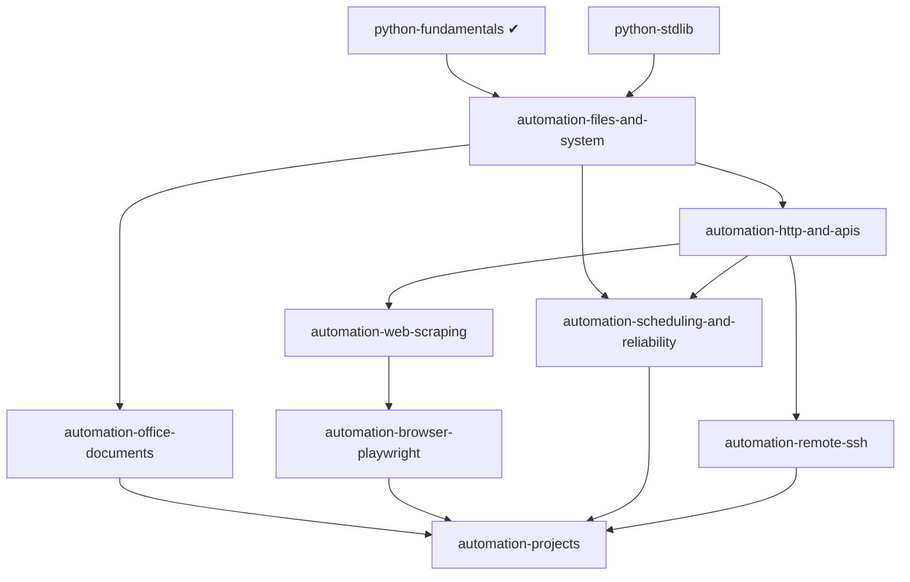

# Python Automation: траектория обучения

Статус: **Planned**. Основа: [python-ecosystem.md](python-ecosystem.md). Часть материала (файлы, `subprocess`, `json` / `csv`, `logging`,
`datetime`) работает уже на текущем движке; сторонние библиотеки требуют Python Environment Manager (в разработке).

Этическое правило курса: автоматизация только своих данных и систем и там, где это разрешено условиями сервиса и `robots.txt`.
Курс **не учит** обходу защит, CAPTCHA, ограничений доступа и несанкционированному доступу.

## 1. Граф

## 2. Курсы

| Курс | Ур. | Требует | Технологии | Проверяемые навыки | Движок |
|---|---|---|---|---|---|
| `automation-files-and-system` | 2 | fundamentals, stdlib | `pathlib`, `shutil`, `tempfile`, `glob`, `subprocess`, `watchdog` | Написать скрипт, безопасно перемещающий файлы (сухой прогон, отсутствие перезаписи); корректно вызвать `subprocess` без `shell=True` | stdlib - есть (песочница ограничивает запись рабочим каталогом); `watchdog` - окружение |
| `automation-http-and-apis` | 3 | files | `requests`, HTTPX, повторы с экспоненциальной задержкой, пагинация, лимиты, таймауты | Клиент с таймаутом, ретраями и уважением к `429` / `Retry-After` | сеть в песочнице запрещена: тестирование на локальном фейковом сервере (**Planned**) |
| `automation-web-scraping` | 3 | http | BeautifulSoup, lxml, Scrapy | Разбор HTML из сохранённых страниц; вежливая частота запросов; обработка отсутствующих элементов | разбор сохранённого HTML - офлайн, возможен |
| `automation-browser-playwright` | 4 | scraping | Playwright, Selenium (сравнение) | Автотест страницы с ожиданиями вместо `sleep` | установка браузеров и Workspaces - Planned |
| `automation-office-documents` | 3 | files | `openpyxl`, `python-docx`, `pypdf`, Pillow | Сгенерировать отчёт xlsx / docx из CSV; извлечь текст из PDF; проверить результат читающим кодом | окружение |
| `automation-scheduling-and-reliability` | 3-4 | files, http | APScheduler, `logging`, идемпотентность, блокировки, обработка сбоев | Скрипт можно безопасно запускать повторно; логи позволяют восстановить ход | окружение |
| `automation-remote-ssh` | 4 | http | Paramiko, Fabric; управление ключами | Выполнить команду на тестовом хосте; не хранить пароли и ключи в коде | внешний хост - Planned |
| `automation-gui-input` (обзор) | 3 | files | PyAutoGUI, pynput | Понять ограничения и риски; запуск только на тестовых окнах | не запускается в песочнице; только теория |

Сквозные темы: ограничение частоты, повторы, логирование, безопасное хранение учётных данных (переменные окружения / хранилище
секретов, не в коде), валидация входных данных, идемпотентность.

## 3. Проекты

| Проект | Приёмка |
|---|---|
| Организатор файлов | Сухой прогон показывает план; повторный запуск ничего не меняет; конфликт имён не затирает файлы; тесты на временном каталоге |
| Пакетная обработка CSV → отчёт xlsx/docx | Результат проверяется повторным чтением; некорректные строки попадают в отдельный отчёт; детерминированный вывод |
| Мониторинг (опрос API по расписанию) | Таймаут и ретраи; без дублей уведомлений (идемпотентность); логи с уровнями |
| Скрейпер сохранённых страниц | Устойчив к изменённой вёрстке (явные ошибки, а не пустые данные); уважает `robots.txt` (проверка кодом) |

## 4. Совместимость

PyAutoGUI / pynput требуют GUI-сессии и разрешений ОС (macOS: доступ к универсальному доступу); Playwright скачивает браузеры
(объём сотни МБ - только по явному действию). Проверено только на macOS arm64.

## 5. Порядок реализации

`automation-files-and-system` (текущий движок) → окружения → `office-documents`, `scraping` (офлайн-ввод) → `http-and-apis`
(после решения о сети для тестов) → `scheduling` → `browser` → `remote-ssh`.
