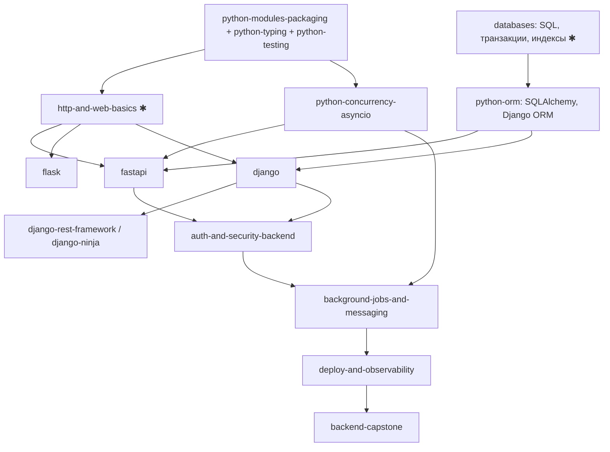

# Python Backend: траектория обучения

Статус: **Planned** (курсов нет; в каталоге есть планируемые треки `django`, `fastapi`). Требует: [python-ecosystem.md](python-ecosystem.md)
(ядро), общие курсы «Базы данных», «Сети», «Системный дизайн». Рабочие названия курсов - предложения.

## 1. Граф

✱ - общие курсы.

## 2. Курсы

| Курс | Ур. | Требует | Технологии | Проверяемые навыки | Движок |
|---|---|---|---|---|---|
| `http-and-web-basics` ✱ | 2 | python-fundamentals | HTTP, методы, коды, заголовки, куки, CORS, REST-принципы | Прочитать сырой запрос и ответ; выбрать код ответа для ситуации | stdlib `http.server` на loopback (нужно решение по сети в песочнице) |
| `python-orm` | 3 | SQL, modules | SQLAlchemy 2.x (Core и ORM), Alembic, Django ORM, SQLModel (обзор), Peewee / Tortoise (обзор); psycopg, asyncpg | Показать SQL, который порождает запрос ORM; устранить N+1; написать миграцию | окружение + SQLite (stdlib) для начальных упражнений, PostgreSQL - внешняя служба (**Planned**) |
| `flask` | 3 | http, modules | app factory, blueprints, контекст запроса, расширения | Построить приложение с фабрикой и blueprint; объяснить контексты | Environment Manager + запуск сервера |
| `fastapi` | 3-4 | http, asyncio, typing | Pydantic, внедрение зависимостей, async, OpenAPI, WebSocket, фоновые задачи; Starlette как основа | Описать модель с валидацией; ошибки в формате API; тесты через тестовый клиент | то же |
| `django` | 3-4 | http, orm | структура проекта, ORM, миграции, админка, формы, middleware, шаблоны | Спроектировать приложение с моделями и миграциями; права доступа | то же |
| `django-rest-framework`, `django-ninja` | 4 | django | сериализаторы, ViewSets, пагинация; Ninja (обзор) | API со схемами, пагинацией, правами | то же |
| `litestar`, `sanic`, `aiohttp` | 4 | fastapi | обзор по шаблону: назначение, архитектура, решаемые проблемы, структура, API, БД, auth, тесты, безопасность, деплой | Сравнить по критериям (режим сравнения) | то же |
| `auth-and-security-backend` | 4 | fastapi / django | сессии и токены, хеширование паролей, OWASP-классы уязвимостей, rate limiting, секреты | Найти и устранить SQL-инъекцию и XSS в готовом приложении; хранение паролей без обратимости | то же |
| `background-jobs-and-messaging` | 4 | asyncio, auth | Celery, Dramatiq, RQ, ARQ, APScheduler, FastStream, aio-pika, confluent-kafka; Redis, RabbitMQ, Kafka | Идемпотентная задача с повторами, расписанием и dead-letter; объяснить acks | брокеры - внешние службы / контейнеры (**Planned**) |
| `deploy-and-observability` | 4-5 | jobs | контейнеры, конфигурация, логи, метрики, health-check | Образ без секретов, непривилегированный пользователь; health-check | Docker (опционально) |

### Асинхронность и конкурентность

Курс `python-concurrency-asyncio` (общее ядро): event loop, корутины, Tasks, Futures, отмена, таймауты, семафоры, блокировки,
очереди, `TaskGroup` (структурная конкурентность); aiohttp, HTTPX, AnyIO, Trio, uvloop (обзор); потоки, процессы, executors;
конкурентность vs параллелизм, CPU- vs I/O-нагрузка; GIL и free-threaded сборки (PEP 703) - без устаревших упрощений, статус
поддержки по версиям сверять с документацией; гонки и взаимные блокировки.

### Базы данных и ORM

Поддерживаемые темы: PostgreSQL, MySQL, SQLite, Redis, MongoDB (Motor / PyMongo); проектирование, связи, транзакции и ACID,
индексы, оптимизация запросов, пулы соединений, асинхронный доступ, миграции, уровни изоляции, взаимные блокировки, репликация,
кэширование. Для ORM обязательно показывать SQL и упражнения по анализу запроса. SQLite доступен без внешних служб; серверные СУБД
требуют Project Workspaces / контейнеров - Planned.

## 3. Сравнения (Planned)

Django vs FastAPI vs Flask; SQLAlchemy vs Django ORM; Celery vs Dramatiq vs RQ. По фиксированным критериям, без «лучшего».

## 4. Проекты

| Проект | Приёмка |
|---|---|
| REST API (FastAPI): ресурсы, валидация, пагинация | Схема OpenAPI соответствует поведению; ошибки валидации в едином формате; тесты (pytest) на успешные и ошибочные ветки; запросы параметризованы |
| Блог / CMS (Django) | Миграции применяются на чистой БД; права редактора и читателя проверены тестами; нет N+1 на главной (проверка числа запросов) |
| Сервис с очередью заданий | Задача идемпотентна (повторная доставка не дублирует эффект); ретраи с задержкой; необработанные попадают в DLQ; тест на отказ брокера |
| Capstone: многопользовательский сервис с auth, БД, фоновыми задачами, контейнером | Все критерии выше + аутентификация без хранения паролей в открытом виде, секреты вне образа, README с запуском |

Для каждого проекта: требования, архитектура, этапы, тесты, дополнительные задания, оценка. ИИ-тьютор помогает без выдачи решения,
если его не просят.

## 5. Совместимость

Серверные фреймворки, СУБД и брокеры - не часть DevAcademy: используются установленные в окружении пакеты и внешние службы
(Docker). Проверяется только macOS arm64. Сеть в песочнице запрещена; упражнения с локальным сервером требуют решения о loopback
в `OsSandbox` и/или режима `Container` с портами - **не реализовано**.

## 6. Порядок реализации

1. Общие: modules-packaging, typing, testing, asyncio (зависят от Environment Manager).
2. `python-orm` на SQLite → `fastapi` → `django` → `flask`.
3. `auth-and-security-backend` → `background-jobs-and-messaging` (после Docker-интеграции) → `deploy-and-observability` → capstone.
