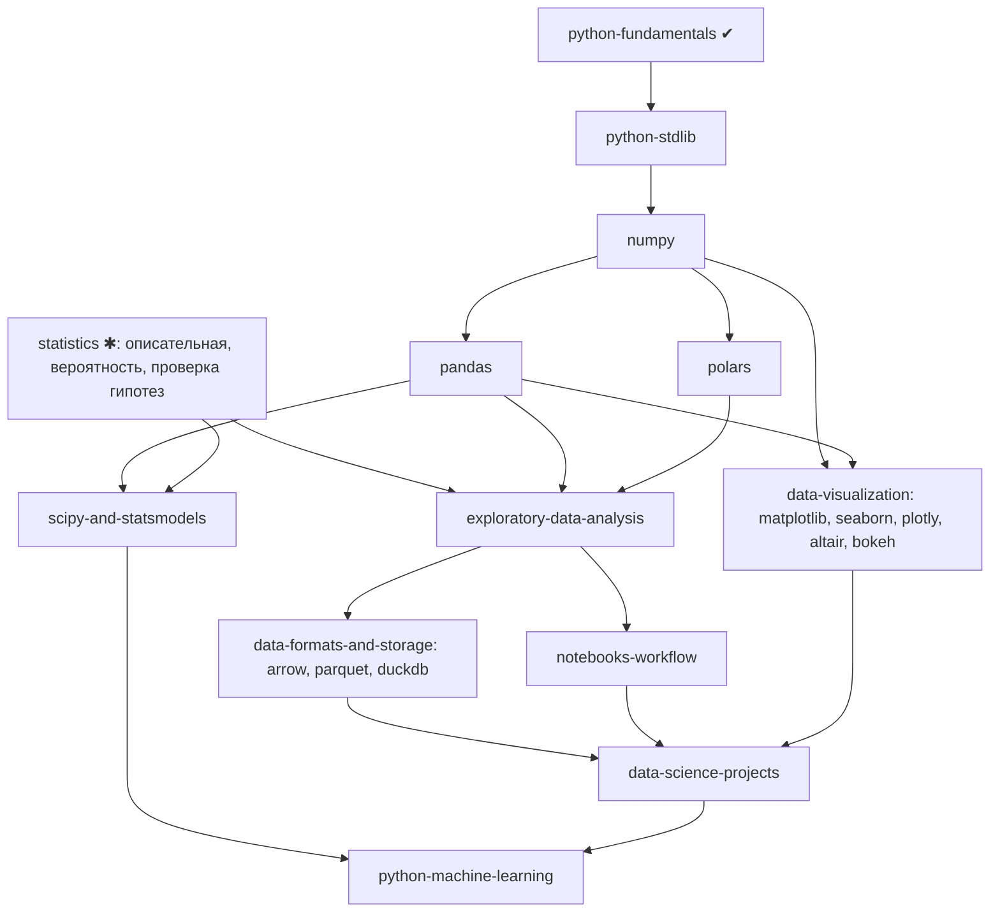

# Python Data Science: траектория обучения

Статус: **Planned**. Все курсы требуют сторонних пакетов, то есть Python Environment Manager (в разработке). Основа:
[python-ecosystem.md](python-ecosystem.md). Продолжение: [python-machine-learning.md](python-machine-learning.md).

## 1. Граф

## 2. Курсы

| Курс | Ур. | Требует | Технологии | Проверяемые навыки | Движок |
|---|---|---|---|---|---|
| `numpy` | 2-3 | stdlib | `ndarray`, dtype, shape, векторизация, broadcasting, срезы vs копии, память | Заменить цикл векторизацией и измерить; предсказать результат broadcasting; объяснить view vs copy; список vs ndarray (память, скорость) | окружение; проверки shape / dtype / допуски |
| `pandas` | 3 | numpy | `Series`, `DataFrame`, индексы, группировка, `merge` / `join`, пропуски, типы, память | Объединить таблицы без потери строк (проверка размера); корректно обработать `NaN`; избежать `SettingWithCopy` | окружение |
| `polars` | 3 | numpy | выражения, ленивые вычисления (lazy) vs eager, Arrow | Переписать конвейер Pandas на Polars с тем же результатом; объяснить план запроса | окружение |
| `exploratory-data-analysis` | 3 | pandas \| polars, statistics | профилирование, распределения, выбросы, корреляция vs причинность, утечки | Составить отчёт EDA, где каждый вывод подкреплён числом; найти утечку целевой переменной в данных | окружение |
| `data-visualization` | 3 | pandas | Matplotlib, Seaborn, Plotly, Bokeh, Altair | Выбрать тип графика под задачу; объяснить, чем вводят в заблуждение усечённые оси; проверить данные на графике кодом | окружение; вывод картинок в UI - Planned |
| `data-formats-and-storage` | 3 | pandas | CSV vs Parquet, PyArrow, колоночное хранение, DuckDB (SQL по файлам) | Сравнить размер / скорость форматов; решить аналитическую задачу на SQL в DuckDB | окружение |
| `scipy-and-statsmodels` | 3-4 | statistics | SciPy (оптимизация, статистика), statsmodels (регрессии, тесты) | Провести тест гипотез и интерпретировать p-value без типичных ошибок; доверительные интервалы | окружение |
| `notebooks-workflow` | 3 | pandas | Jupyter: ячейки, состояние ядра, воспроизводимость | Ноутбук воспроизводится сверху вниз после перезапуска ядра | **Notebook workspace (Planned)**: Jupyter-протокол, ipykernel |
| `data-science-projects` | 4 | выше | сквозные проекты | см. ниже | окружение |

Сравнения (Planned): Pandas vs Polars (eager / lazy, память, API), Matplotlib vs Plotly (статика / интерактив).

## 3. Критерии мастерства (общие)

Результаты упражнений воспроизводимы: фиксированные seed, датасеты входят в курс или генерируются детерминированно, числа сравниваются
с допусками, проверяются shape / dtype; ответ «скрипт отработал» не засчитывается. Датасеты небольшие и распространяются
офлайн вместе с курсом, лицензия указывается.

## 4. Проекты

| Проект | Приёмка |
|---|---|
| Очистка и EDA датасета | Тесты на очищенную таблицу: типы, отсутствие дублей, документированная политика пропусков; отчёт воспроизводим |
| Аналитический дашборд (графики из агрегатов) | Агрегаты совпадают с эталоном в допуске; подписи осей и единицы; без запрещённых приёмов искажения шкал |
| Конвейер Parquet + DuckDB | Идемпотентный запуск; схема проверяется; сравнение времени с CSV зафиксировано |
| Анализ A/B-теста | Корректный тест, интерпретация, оговорки о мощности; код возвращает структурированный результат, проверяемый тестами |

## 5. Совместимость

NumPy / Pandas / Polars / SciPy / PyArrow - сторонние пакеты; наличие бинарных колёс зависит от версии Python, ОС и архитектуры
(на новых версиях Python колёса могут запаздывать - Environment Manager запоминает версию Python / ОС / архитектуру). GPU не нужен.
Проверено только на macOS arm64. Сеть в песочнице запрещена: все датасеты локальны.

## 6. Порядок реализации

Environment Manager → `numpy` → `pandas` → `data-visualization` → `exploratory-data-analysis` → `polars`, `data-formats-and-storage` →
`scipy-and-statsmodels` → notebooks (после Notebook workspace) → проекты.
