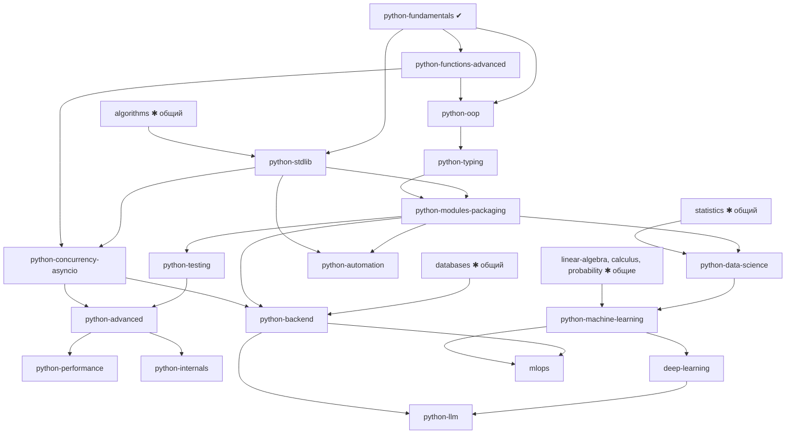

# Экосистема Python: общая карта

Статус: реализован только `python-fundamentals` (10 уроков, одиночные файлы, только стандартная библиотека). Всё остальное -
**Planned**. Идентификаторы курсов - рабочие предложения. Специализации: [backend](python-backend.md),
[automation](python-automation.md), [data science](python-data-science.md), [machine learning](python-machine-learning.md),
[LLM](python-llm.md). Модель: [CURRICULUM.md](../../CURRICULUM.md).

Принцип: понятие изучается один раз (например, функции) и переиспользуется; специализации добавляют упражнения предметной
области, а не повторяют теорию. Python-специализации: Fundamentals, Advanced, Backend, Automation, Data Science, ML, Deep
Learning, AI/LLM, Computer Vision, NLP, Data Engineering, DevOps, Desktop, Testing, Performance, Security, Internals.

## 1. Ядро (Fundamentals) по уровням

| Уровень ядра | Темы | Статус |
|---|---|---|
| L0 Старт | CPython, интерпретатор, REPL, скрипты, терминал, IDE, pip, uv, venv | урок 1 (`how-python-runs`) есть; pip / uv / venv - Planned (нужен Environment Manager) |
| L1 Синтаксис | переменные и имена, числа, условия, циклы, функции, строки | уроки 2-7 есть |
| L2 Структуры данных | списки, словари, множества есть; кортежи, frozenset, hashability, сложность операций | уроки 8-9 частично; остальное Planned |
| L3 Функции и абстракции | функции первого класса, lambda, замыкания, декораторы, рекурсия, генераторы / итераторы / `yield`, контекстные менеджеры, `functools`, `itertools` | Planned |
| L4 ООП | `classmethod` / `staticmethod`, наследование и композиция, ABC, Protocol, свойства, dataclasses, dunder-методы, дескрипторы | Planned |
| L5 Исключения и файлы | иерархия, цепочки, `pathlib` / `os` / `shutil` / `tempfile`, `json`, `csv`, сериализация, `logging` | урок 10 (основы) есть; остальное Planned |
| L6 Модули и пакеты | система импорта, `__init__.py`, разрешение имён, `PYTHONPATH`, `pyproject.toml`, упаковка | Planned (многофайловые проекты и окружения) |
| L7 Типизация | подсказки типов, generics, `TypeVar`, `Protocol`, `TypedDict`, `Literal`, `Union` / `Optional`, `Callable`, `ParamSpec`, сужение, mypy / Pyright; типы времени выполнения и статическая проверка - разные вещи | Planned |

## 2. Стандартная библиотека

Для каждого модуля: назначение, ключевые API, примеры, типичные ошибки, производительность, ограничения, упражнения. Стандартной
библиотеке отдаётся приоритет перед сторонними пакетами. Всё это работает на текущем движке (одиночные файлы).

| Группа | Модули |
|---|---|
| Структуры | `collections`, `heapq`, `bisect`, `array`, `enum` |
| Функциональное | `functools`, `itertools`, `operator` |
| Файлы и система | `pathlib`, `os`, `sys`, `shutil`, `tempfile`, `subprocess`, `glob` |
| Данные | `json`, `csv`, `pickle`, `struct`, `configparser` |
| Время и числа | `datetime`, `time`, `math`, `statistics`, `decimal`, `fractions`, `random` |
| Конкурентность | `threading`, `multiprocessing`, `concurrent.futures`, `asyncio`, `queue` |
| Сеть | `socket`, `ssl`, `urllib`, `http`, `email` |
| Качество | `logging`, `traceback`, `pdb`, `unittest`, `doctest`, `cProfile`, `timeit`, `tracemalloc` |
| Интроспекция | `inspect`, `importlib`, `ast`, `dis`, `gc`, `weakref`, `ctypes`, `contextlib` |

Ограничение текущего раннера: сеть запрещена в `OsSandbox`, поэтому упражнения по `socket` / `http` / `urllib` делаются на
loopback только после решения по доступу к сети в песочнице (**Planned**), а `subprocess` и `multiprocessing` ограничены лимитами
процессов и памяти.

## 3. Граф зависимостей

✱ - общие курсы: преподаются один раз, в Python-путях дают упражнения-варианты на Python. Три «общих» узла (algorithms, databases,
statistics) в каталоге присутствуют как треки `planned`.

Примеры путей: «Python-разработчик (backend)»: fundamentals → functions-advanced → oop → typing → modules-packaging →
testing → databases → backend; «Data scientist»: fundamentals → stdlib → data-science → statistics → machine-learning; кто
уже владеет SQL, пропускает его после входной проверки (assessment credit).

## 4. Схема курсов ядра и продвинутых тем

| Курс | Ур. | Требует | Проверяемые навыки | Движок |
|---|---|---|---|---|
| `python-fundamentals` ✔ | 0 | - | Предсказывать вывод; объяснять имена / объекты; писать функции, работать со строками, списками, словарями, исключениями | есть |
| `python-functions-advanced` | 2 | fundamentals | Написать декоратор с `functools.wraps`; генератор вместо списка; объяснить замыкание в цикле | есть |
| `python-oop` | 2-3 | functions | Выбрать композицию или наследование и обосновать; реализовать `__eq__` / `__hash__` согласованно; `dataclass(frozen=True)` | есть |
| `python-stdlib` | 2-3 | fundamentals | Решить задачи на `collections` / `itertools` / `pathlib` / `json` без сторонних пакетов | есть |
| `python-typing` | 3 | oop | Типизировать generic-контейнер и `Protocol`; объяснить, что mypy не проверяет в рантайме | mypy / Pyright - Command evaluator + окружение |
| `python-modules-packaging` | 3 | typing | Собрать пакет с `pyproject.toml`; объяснить, почему импорт не находит модуль | **Environment Manager + многофайловые проекты** |
| `python-testing` | 3 | modules | pytest: фикстуры, параметризация, Hypothesis; покрытие; тест ловит внесённый баг | Command evaluator (pytest) + окружение |
| `python-concurrency-asyncio` | 3-4 | stdlib, functions | `asyncio`: Tasks, отмена, таймауты, `TaskGroup`; различать CPU- и I/O-нагрузку; GIL и free-threaded сборки (PEP 703; статус поддержки сверить по документации используемой версии) | есть для stdlib; сеть ограничена |
| `python-advanced` | 4 | testing, concurrency | Метаклассы и дескрипторы там, где уместны; управление ресурсами | есть |
| `python-performance` | 4-5 | advanced | Профилирование (`cProfile`, `timeit`, `tracemalloc`), векторизация, C-расширения (Cython, pybind11, Numba) | окружение + компилятор |
| `python-internals` | 5-6 | advanced | Байткод (`dis`), AST, счётчик ссылок и GC, система импорта | есть |

## 5. Дополнительные направления (фаза J, Planned)

Computer Vision (OpenCV, Pillow, torchvision, Ultralytics, Detectron2, timm, Albumentations); NLP (NLTK, spaCy, Gensim, Sentence
Transformers, HF Transformers, tokenizers); Reinforcement Learning (Gymnasium, Stable-Baselines3, RLlib, PettingZoo: от MDP до PPO,
воспроизводимые среды); Data Engineering (Pandas, Polars, PyArrow, DuckDB, SQLAlchemy, Airflow, Prefect, Dagster, PySpark, dbt;
основы не должны требовать Spark или Kubernetes); DevOps; Security; Desktop GUI (Tkinter, PySide6, PyQt6, Kivy, Flet, Textual -
изучаются как технологии; интерфейс DevAcademy на них не строится).

## 6. Среда выполнения и совместимость

* Сейчас упражнения запускаются системным интерпретатором (`python -E -s -B -X utf8`), без сторонних пакетов. Совместимость: любой
  Python 3, найденный в PATH; учебные примеры ориентированы на актуальные 3.x - версия определяется и показывается.
* Окружения (`venv`, `uv`), явная установка зависимостей, список пакетов, запуск в окружении - **Python Environment Manager (в
  разработке)**. Установка глобально без явного решения пользователя запрещена; учитываются версия Python, ОС, архитектура CPU,
  ускоритель.
* Упражнения без сторонних пакетов должны работать офлайн; курсы с пакетами объявляют зависимости заранее.
* Платформа проверки: macOS arm64; для Linux/Windows см. [PLATFORM_SUPPORT.md](../../PLATFORM_SUPPORT.md).

## 7. Критерии приёмки возможностей (из требований)

Сверка с текущим состоянием: выбор Python и специализации, путь, теория, код, запуск, тесты одного файла, подсказки ИИ,
сохранение прогресса и возобновление после перезапуска, офлайн-упражнения - **работают**. Выбор интерпретатора, создание venv,
установка зависимостей, многофайловый проект, изучение библиотеки с установкой, ноутбуки, датасеты ML, CPU-упражнения ML, GPU,
LLM-инференс, RAG, дообучение, развёртывание сервиса инференса - **не реализованы**.

## 8. Порядок реализации

1. Доделать ядро на текущем движке: `python-functions-advanced`, `python-oop`, `python-stdlib` (не требуют окружений).
2. Python Environment Manager → `python-modules-packaging`, `python-testing`, `python-typing`.
3. Command evaluator (pytest, mypy) как проверка.
4. `python-concurrency-asyncio`, `python-advanced`, затем специализации в порядке: backend → data science → ML → deep learning →
   LLM → MLOps → остальное.
