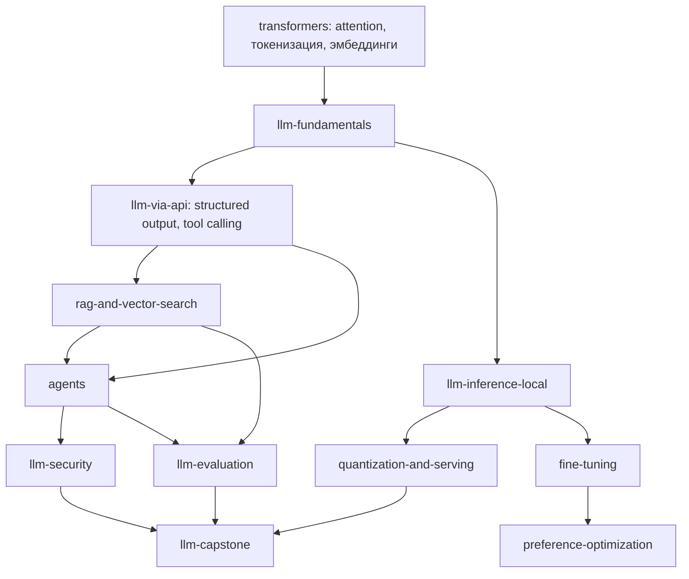

# Python: LLM и генеративный ИИ

Статус: **Planned**. Требует: [python-machine-learning.md](python-machine-learning.md) (особенно трансформеры),
[python-backend.md](python-backend.md) (для сервисов). Среда: Python Environment Manager, ML Runtime Manager (Planned). В каталоге -
трек `llm-genai` (`planned`).

Во всех уроках различаются пять понятий: **использование готовой модели (API)**, **инференс локальной модели**, **дообучение**,
**обучение с нуля**, **развёртывание (serving)**. Курс не смешивает их и не обещает, что дообучение выполнимо на любом ноутбуке.

## 1. Граф

## 2. Курсы

| Курс | Ур. | Требует | Технологии | Проверяемые навыки | Движок |
|---|---|---|---|---|---|
| `llm-fundamentals` | 4 | transformers | токенизаторы (tokenizers, BPE), эмбеддинги, контекстное окно, Hugging Face Transformers | Подсчитать токены разных строк и объяснить различия; реализовать mini-GPT forward на малых размерах | CPU |
| `llm-via-api` | 4 | fundamentals, backend | API провайдеров, потоковая выдача, структурированный вывод, вызов инструментов, обработка ошибок и лимитов | Клиент с таймаутом, повтором и валидацией JSON-ответа; **упражнения проверяются на фейковом сервере, а не на платном API** | сеть запрещена в песочнице: локальный фейк (Planned) |
| `llm-inference-local` | 4-5 | fundamentals | Transformers, llama-cpp-python, ONNX Runtime; семплинг (temperature, top-p / top-k), KV-кэш, пакетирование, стриминг | Объяснить, как семплинг влияет на распределение; измерить память и скорость для разных размеров | CPU на малых моделях; GPU опционально; загрузка весов только по явному действию (размер, лицензия) |
| `quantization-and-serving` | 5 | inference | bitsandbytes, GGUF, vLLM, ONNX Runtime | Сравнить качество и память для разных квантизаций на зафиксированном наборе | зависит от ускорителя: bitsandbytes и vLLM связаны с CUDA/Linux; на macOS - другие пути (сверить) |
| `rag-and-vector-search` | 4 | api | эмбеддинги, FAISS, Chroma, Qdrant, pgvector; LangChain, LlamaIndex (сравнение); чанкинг, поиск, оценка | Построить RAG с измеримым recall@k на фикс. наборе; объяснить, когда RAG не нужен | окружение; локальные векторные базы |
| `fine-tuning` | 5 | inference | PEFT, LoRA, QLoRA, SFT, TRL, Accelerate, Diffusers (для изображений) | Описать, что именно обновляется при LoRA; запустить мини-дообучение на крошечной модели с проверкой снижения loss; сохранить и загрузить адаптер | CPU - только игрушечные модели; реальное дообучение требует GPU и не является обязательным упражнением |
| `preference-optimization` | 5-6 | fine-tuning | DPO и родственные методы, TRL | Объяснить функцию потерь и источники смещения | теория + игрушечные примеры |
| `agents` | 5 | api, rag | LangGraph, вызов инструментов, разрешения, восстановление после ошибок, оценка | Агент с ограниченным набором инструментов, лимитом шагов и подтверждением опасных действий; тест на отказ инструмента | фейковые инструменты |
| `llm-security` | 5 | agents | prompt injection, утечки данных, небезопасные инструменты, валидация вывода | Найти инъекцию через данные и закрыть: изоляция недоверенного ввода, минимальные права, валидация вывода | эксперименты на локальных моделях / фейках |
| `llm-evaluation` | 5 | rag, agents | наборы оценки, метрики, ошибки LLM-судьи | Построить воспроизводимую оценку с зафиксированным набором и порогами | окружение |
| `llm-capstone` (развёртывание сервиса инференса) | 5 | serving, security | FastAPI + модель, лимиты, наблюдаемость, контейнер | Сервис выдерживает заданную нагрузку в рамках тестового профиля; лимиты запросов; без утечки секретов | Docker; железо-зависимо |

## 3. Принципы проверки

* Нельзя зависеть от платных API: проверки детерминированы (фейковые клиенты, записанные ответы, крошечные локальные модели с
  зафиксированным seed).
* «Скрипт завершился» не успех: проверяются форма вывода, метрики на скрытом наборе, поведение при ошибках, соблюдение лимитов.
* Загрузка весов и датасетов - только по явному действию пользователя с указанием размера и лицензии.
* ИИ-тьютор DevAcademy не подменяет проверки; ключи провайдеров хранятся только в хранилище секретов ОС
  ([AI_PROVIDERS.md](../../AI_PROVIDERS.md)).

## 4. Проекты

| Проект | Приёмка |
|---|---|
| Чат-приложение со стримингом | Корректная отмена и обработка обрыва; лимит контекста; тест на фейковом провайдере |
| RAG по локальной документации | recall@k не ниже порога на фикс. наборе; ответы содержат ссылки на источники; отказ при отсутствии источника |
| Дообучение малой модели (LoRA) | Loss снижается на валидации; адаптер загружается и меняет вывод на тестовых примерах; воспроизводимо с seed |
| Агент с инструментами | Лимит шагов; опасные действия требуют подтверждения; атака через prompt injection в тестовых данных не приводит к вызову запрещённого инструмента |
| Сервис инференса | Контракт API и нагрузочный тест; конфигурация без секретов; мониторинг метрик |

## 5. Совместимость

Объём моделей и требования к памяти большие: курсы указывают минимальный объём ОЗУ / VRAM. CUDA-ориентированные инструменты
(bitsandbytes, vLLM и др.) не работают на macOS; на Apple Silicon используются иные пути (MPS, llama.cpp / GGUF). Поддержка зависит
от версий - сверять с документацией на момент написания курса. Проверка DevAcademy выполнена только на macOS arm64
([PLATFORM_SUPPORT.md](../../PLATFORM_SUPPORT.md)).

## 6. Порядок реализации

После `deep-learning-pytorch` и ML Runtime Manager: `llm-fundamentals` → `llm-via-api` (фейковый сервер) → `rag-and-vector-search` →
`agents` → `llm-security` → `llm-evaluation` → `llm-inference-local` → `quantization-and-serving` → `fine-tuning` → `llm-capstone`.
