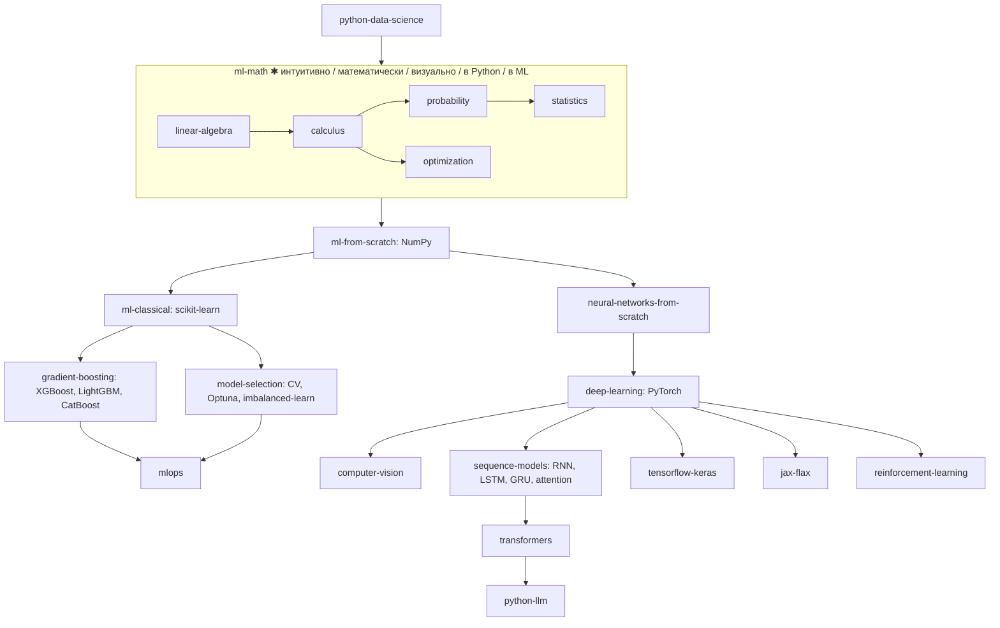

# Python: машинное обучение и глубокое обучение

Статус: **Planned**. Требует: [python-data-science.md](python-data-science.md), общие курсы по линейной алгебре, матанализу,
вероятности, статистике и оптимизации (в каталоге - трек `ml-math`, статус `planned`). Среда: Python Environment Manager (в
разработке) и ML Runtime Manager (Planned).

## 1. Граф

## 2. Курсы и критерии мастерства

Для каждого основного алгоритма два этапа: **A - с нуля** (Python / NumPy), **B - библиотека**; сравниваются корректность,
численная устойчивость, скорость и сложность. Учащийся должен понимать, что делает обучение, а не только вызывать `model.fit()`.

| Курс | Ур. | Требует | Технологии | Проверяемые навыки | Движок |
|---|---|---|---|---|---|
| `ml-math` ✱ | 2-3 | data-science | линейная алгебра, матанализ, вероятность, статистика, оптимизация | Вычислить градиент вручную и подтвердить численно (разностью); разложить матрицу и объяснить смысл | NumPy; визуализации - Planned |
| `ml-from-scratch` | 3 | ml-math | линейная и логистическая регрессия, градиентный спуск, k-NN, деревья, K-Means, PCA на NumPy | Реализация сходится на фикс. данных; результат совпадает с эталоном scikit-learn в допуске | NumPy, CPU |
| `ml-classical` | 3 | from-scratch | scikit-learn, конвейеры, кросс-валидация, метрики, регуляризация | Избежать утечки данных (разбиение до масштабирования); выбрать метрику под задачу и обосновать | CPU |
| `gradient-boosting` | 4 | ml-classical | XGBoost, LightGBM, CatBoost | Объяснить отличия от случайного леса; настроить на валидации без подгонки к тесту | CPU (GPU-режимы - опционально и отдельно) |
| `model-selection-and-tuning` | 4 | ml-classical | Optuna, imbalanced-learn, калибровка, доверительные оценки | Корректный поиск гиперпараметров с вложенной валидацией | CPU |
| `neural-networks-from-scratch` | 3-4 | from-scratch | перцептрон, обратное распространение, автодиф, оптимизаторы, регуляризация, BatchNorm | Реализовать backprop для 2-слойной сети и проверить градиенты численно; обучить на игрушечном датасете до порога точности | NumPy, CPU |
| `deep-learning-pytorch` | 4 | NN-from-scratch | тензоры, autograd, `nn.Module`, циклы обучения, Lightning, Accelerate | Написать обучающий цикл с валидацией, ранней остановкой, сохранением; воспроизводимость (seed) | CPU; GPU опционально |
| `computer-vision` | 4 | deep-learning | CNN, transfer learning, аугментации; OpenCV, torchvision, timm, Albumentations, Ultralytics, Detectron2 | Дообучить модель на малом наборе и измерить; интерпретировать матрицу ошибок | CPU по умолчанию; GPU упражнения отдельно |
| `sequence-models` / `transformers` | 4-5 | deep-learning | RNN / LSTM / GRU, внимание, трансформеры, эмбеддинги | Реализовать scaled dot-product attention и сверить с эталоном; объяснить маскирование | CPU на малых размерностях |
| `tensorflow-keras`, `jax-flax` | 4 | deep-learning | TensorFlow, Keras, JAX, Flax | Повторить тот же эксперимент в другом фреймворке и объяснить различия (режим сравнения) | CPU; см. §4 |
| `reinforcement-learning` | 5 | deep-learning, probability | Gymnasium, Stable-Baselines3, RLlib, PettingZoo; от MDP до PPO | Воспроизводимая среда + агент с фикс. seed достигает порога награды; объяснить разницу on-/off-policy | CPU |
| `mlops` | 4-5 | classical, backend | MLflow, DVC, Optuna, W&B, BentoML, ONNX Runtime, Docker, Kubernetes, FastAPI | Эксперимент, трекинг, экспорт, API-сервис в контейнере | Docker; Kubernetes - обзор |

### Интерактивные визуализации (Planned, математически честные)

Линейная регрессия; **лаборатория градиентного спуска** (выбор функции, шага обучения, стартовой точки; запуск; траектория
параметров и история потерь); деревья решений; K-Means; PCA; нейросети и backprop; умножение матриц; функции активации; функции
потерь; внимание и трансформер; кривые обучения; переобучение / недообучение. Данные визуализации строятся из реального
вычисления (как сейчас `visualize sorting` строится из реальной трассировки сортировки). Сейчас реализована только сортировка.

## 3. Качество ML-упражнений

Воспроизводимые датасеты, фиксированные seed, допуски для чисел, проверки shape / dtype, проверка корректности вычислений, GPU не
обязателен. Обучающий скрипт, который «просто завершился», успехом не считается: проверяются метрика на скрытой выборке, градиенты,
формы, детерминизм. ИИ-тьютор может использовать метаданные датасета, метрики, loss, accuracy и конфиг обучения, но не заменяет
детерминированные проверки.

## 4. Совместимость и ускорители

Обнаружение железа (CPU, NVIDIA / CUDA, AMD / ROCm, Apple Silicon / Metal / MPS, память, драйверы) - задача ML Runtime Manager
(**Planned**). Наличие GPU не означает поддержки фреймворком: проверяются ОС, архитектура, версия фреймворка, версия Python и
реально доступный бэкенд (проба **внутри окружения**, например `torch.cuda.is_available()`).

| Ускоритель | Что учитывать (сверить с документацией фреймворка при написании) |
|---|---|
| CUDA | Нет на macOS. Нужны драйвер NVIDIA и сборка фреймворка с CUDA; Linux и Windows |
| ROCm | Поддержка различается между Linux и Windows и ограничена списком GPU |
| MPS (Metal) | Только Apple Silicon; поддержка есть не во всех фреймворках и операциях, возможен откат на CPU |
| TensorFlow | Нативная поддержка GPU на Windows закончилась на версии 2.10; для новых версий используют WSL2 |
| JAX | GPU на Windows - через WSL2; Metal-бэкенд на Mac считается экспериментальным |

Если ускорение недоступно, приложение объясняет причину; CPU-упражнения работают везде; GPU-упражнения выделены и необязательны.
Статус всех клеток матрицы: **не проверено** ([PLATFORM_SUPPORT.md](../../PLATFORM_SUPPORT.md)).

## 5. Проекты

| Проект | Приёмка |
|---|---|
| Классификатор на табличных данных (sklearn → boosting) | Нет утечки (тест на порядок разбиения); метрика на скрытой выборке ≥ заданного порога; конвейер сериализуется и воспроизводится с seed |
| Нейросеть с нуля на NumPy | Градиенты совпадают с численными в допуске; точность на игрушечном датасете ≥ порога; детерминизм |
| Классификатор изображений (transfer learning) | Протокол обучения: валидация, кривые, сохранение лучшей модели; CPU-вариант задаётся малым подмножеством |
| Production ML Service | Данные → обучение → оценка → трекинг → экспорт → API → контейнер → тесты → деплой → мониторинг; API проходит контрактные тесты; образ без секретов |

Каждый проект: описание, требования, пререквизиты, критерии приёмки, этапы, тесты, дополнительные задания, рекомендации по
архитектуре, оценка.

## 6. Порядок реализации

Environment Manager → `ml-math` (NumPy) → `ml-from-scratch` → `ml-classical` → интерактивные визуализации (параллельно) →
Notebook workspace → `neural-networks-from-scratch` → ML Runtime Manager → `deep-learning-pytorch` → остальные курсы → `mlops`.
